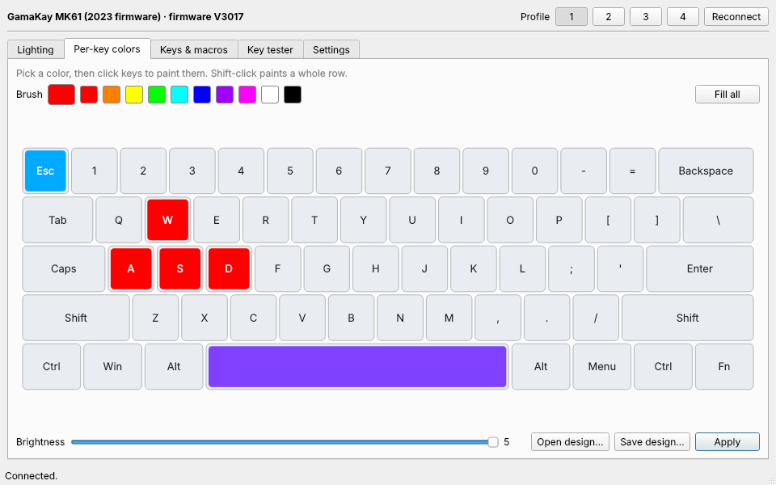

# MK61 Control

Open-source replacement for the official GamaKay driver, for the **GamaKay MK61** 60% keyboard.
Change the lighting, paint each key its own color, remap keys, record macros and switch
profiles, all saved on the keyboard itself.

> Unofficial project, not affiliated with GamaKay. [Türkçe açıklama aşağıda.](#türkçe)



## Why

After the 2023 firmware update (V3017) the MK61 reports itself as `2442:0030` instead of
`1EA7:9018`, and the official "MK Series" software no longer finds it. MK61 Control works with
both versions.

| Keyboard | USB ID | Status |
|---|---|---|
| MK61, 2023 firmware V3017 | `2442:0030` | tested |
| MK61 / SK61L, 2021 firmware | `1EA7:9018` | same protocol, not tested by me |

Check your ID in Device Manager → keyboard → Details → Hardware IDs, or run `mk61control list`.

## Features

- **Lighting**: all 13 hardware effects, effect colors, brightness, speed, direction, backlight on/off
- **Per-key colors**: click keys to paint them, save and share designs as JSON
- **Keys & macros**: remap any key on the normal and Fn layers, record macros with delays and repeat
- **Profiles**: edit and switch the four on-board profiles
- **Key tester**: see which keys the computer receives
- **Settings**: Windows-key lock, arrow swap, backup and restore, factory reset
- **Command line**: everything above is scriptable

The app never touches the firmware.

## Install

### Windows
Download `MK61-Control.exe` from [Releases](https://github.com/omerfarukmmt/mk61-control/releases)
and run it. Windows SmartScreen may warn because the file is not signed: click
**More info → Run anyway**. Close the official GamaKay app first if it is running.

### From source (Windows, macOS, Linux)
```
pip install -r requirements.txt
```
```
python run.pyw
```

On Linux, allow your user to access the keyboard once:
```
sudo cp packaging/linux/99-mk61-control.rules /etc/udev/rules.d/
```
then unplug and replug the keyboard.

## Command line

```
python -m mk61control info
```
```
python -m mk61control light --effect static --color ff5000 --brightness 5
```
```
python -m mk61control light --effect wave --speed 80
```
```
python -m mk61control perkey --base 101010 --key w=ff0000 a=ff0000 s=ff0000 d=ff0000
```
```
python -m mk61control remap --set caps=Esc
```
```
python -m mk61control backup my-keyboard.json
```

Run `python -m mk61control --help` for the full list. Key names are listed in
[`mk61control/layout.py`](mk61control/layout.py).

## Good to know

- **The keyboard cannot report its keymap**, so the app keeps your key assignments in
  `%APPDATA%\mk61-control\profiles.json` (`~/.config/mk61-control` on Linux/macOS). If you remap
  keys with another tool, press *Reset layer to factory* here to start clean.
- **Stuck?** Hold **Fn + Tab for 5 seconds** to reset the keyboard, or use *Settings → Factory reset*.
- Brightness goes from 0 to 5 on firmware V3017.

## What has been tested

On an MK61 with firmware V3017: every lighting effect was written and read back from the
keyboard, as were profile switching, per-key mode, options, keymap and macro commands, and
backup/restore (restored byte for byte). Not yet confirmed by eye on real hardware: how each
effect looks, and remapped keys and macros firing when typed. Please
[open an issue](https://github.com/omerfarukmmt/mk61-control/issues) if something behaves differently on your keyboard.

## Credits

- Protocol details from the official GamaKay "MK Series" driver and the
  [MK61-Studio](https://github.com/d4nielrx/MK61-Studio) project (MIT), which documented the
  2021 firmware first. See [PROTOCOL.md](PROTOCOL.md).

## License

MIT

---

## Türkçe

**MK61 Control**, GamaKay MK61 klavye için resmi driver'ın yerine kullanılabilecek, açık kaynaklı
ve resmi olmayan bir uygulamadır.

2023 firmware güncellemesinden (V3017) sonra klavye kendini `2442:0030` olarak tanıtıyor ve
resmi "MK Series" yazılımı onu bulamıyor. Bu uygulama her iki sürümle de çalışır.

**Neler yapabilirsin**
- 13 donanım efekti, efekt renkleri, parlaklık, hız ve yön ayarı
- Tuş başına renk: tuşlara tıklayıp boyayabilir, tasarımını JSON olarak kaydedebilirsin
- Normal ve Fn katmanında tuş atama, gecikme ve tekrar destekli makro kaydı
- 4 profil arasında geçiş ve profil düzenleme
- Tuş test ekranı, Windows tuşu kilidi, yedekleme/geri yükleme, fabrika ayarları

Bütün ayarlar klavyenin kendi hafızasına yazılır, uygulama kapalıyken de kalır. Uygulama
firmware'e hiçbir şekilde dokunmaz.

**Kurulum (Windows):** [Releases](https://github.com/omerfarukmmt/mk61-control/releases)
sayfasından `MK61-Control.exe` dosyasını indirip çalıştır. Dosya imzalı olmadığı için Windows
uyarı verebilir: **Ek bilgi → Yine de çalıştır**'a tıkla. Resmi GamaKay uygulaması açıksa kapat.

**Klavye takılı kalırsa:** Fn + Tab'a 5 saniye basılı tut, klavye fabrika ayarlarına döner.
